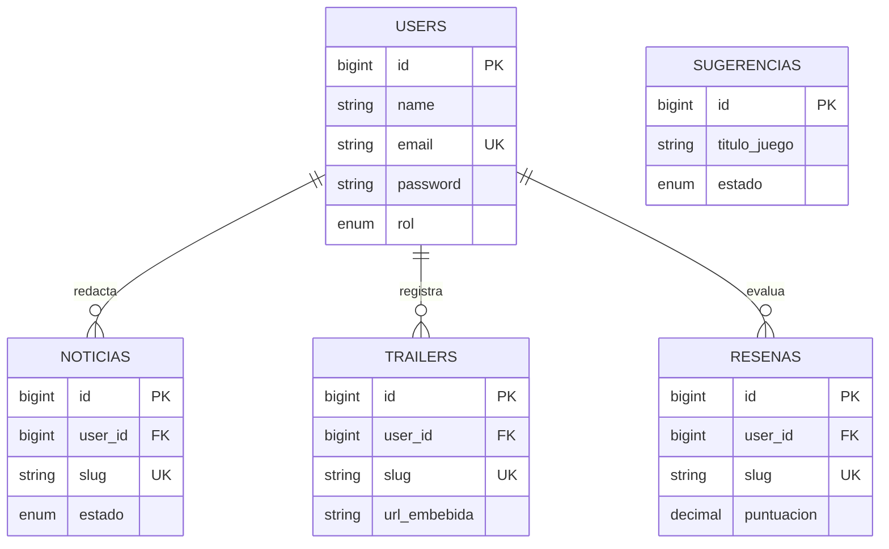

# 3. Base de datos  _(secciones 10 y 12)_

## 10.1 Entidades
`users` (equipo editorial), `noticias`, `trailers`, `resenas`, `sugerencias` (+ tablas técnicas `sessions`, `password_reset_tokens`).

## 10.2 Diagrama entidad-relación

`sugerencias` no se relaciona con `users`: la envían lectores sin cuenta.

## 10.3 Modelo relacional
- users(**id**, name, email, email_verified_at, password, rol, remember_token, created_at, updated_at)
- noticias(**id**, #user_id→users.id, titulo, slug, resumen, contenido, imagen_portada, categoria, plataforma, estado, timestamps)
- trailers(**id**, #user_id→users.id, titulo, slug, videojuego, plataforma, url_embebida, descripcion, estado, timestamps)
- resenas(**id**, #user_id→users.id, titulo, slug, videojuego, desarrollador, genero, plataforma, puntuacion, pros, contras, veredicto, imagen_portada, estado, timestamps)
- sugerencias(**id**, nombre, email, titulo_juego, plataforma, comentario, estado, timestamps)

## 10.4 Diccionario de datos
**users**
| Campo | Tipo | Restricciones |
|---|---|---|
| id | BIGINT UNSIGNED | PK, autoincremental |
| name | VARCHAR(100) | NOT NULL |
| email | VARCHAR(150) | UNIQUE, NOT NULL |
| password | VARCHAR(255) | NOT NULL, hash Bcrypt |
| rol | ENUM('admin','editor') | DEFAULT 'editor' |

**noticias**
| Campo | Tipo | Restricciones |
|---|---|---|
| id | BIGINT UNSIGNED | PK |
| user_id | BIGINT UNSIGNED | FK users.id, RESTRICT |
| titulo | VARCHAR(200) | NOT NULL |
| slug | VARCHAR(220) | UNIQUE |
| resumen | VARCHAR(300) | NULL |
| contenido | LONGTEXT | NOT NULL |
| imagen_portada | VARCHAR(255) | NULL (≤5 MB al subir) |
| categoria | VARCHAR(50) | NOT NULL |
| plataforma | ENUM(PC,PlayStation,Xbox,Nintendo) | NULL |
| estado | ENUM('borrador','publicado') | DEFAULT 'borrador' |

**trailers**: igual base + `videojuego VARCHAR(150)`, `plataforma ENUM(PC,PlayStation,Xbox,Nintendo,Multi) NOT NULL`, `url_embebida VARCHAR(255) NOT NULL`, `descripcion TEXT NULL`.

**resenas**: base + `videojuego VARCHAR(150)`, `desarrollador VARCHAR(120)`, `genero VARCHAR(80)`, `plataforma ENUM(...) NOT NULL`, `puntuacion DECIMAL(3,1) NOT NULL CHECK 1.0–10.0`, `pros/contras/veredicto TEXT NOT NULL`, `imagen_portada NULL`.

**sugerencias**: `nombre VARCHAR(80)`, `email VARCHAR(150)`, `titulo_juego VARCHAR(120)`, `plataforma ENUM`, `comentario VARCHAR(500) NULL`, `estado ENUM('pendiente','revisada') DEFAULT 'pendiente'`.

### Diferencias respecto al protocolo (documentar en el manuscrito)
1. La tabla se llama `users` (no `usuarios`) por compatibilidad con la autenticación de Laravel.
2. Se agregaron `noticias.resumen` y `noticias.plataforma` (necesarios para tarjetas y RF-05), `resenas.desarrollador` y `resenas.genero` (exigidos por RF-04) y la tabla `sugerencias` (formulario público).
3. Las tablas de contenido usan nombres sin tilde (`resenas`).

## 10.5–10.6 Llaves e integridad
- PK `id` en todas las tablas; FK `user_id` en noticias/trailers/resenas con `restrictOnDelete`.
- `slug` UNIQUE; índices por `(estado, created_at)` y `plataforma`.
- CHECK de puntuación en MySQL/MariaDB; validación equivalente en `ResenaRequest` y `Resena::validarPuntuacion`.
- Regla de aplicación: no se elimina un usuario con contenido (`User::tieneContenido`) ni a uno mismo.

## 10.7 Migraciones, seeders y factories
Migraciones en `database/migrations` (users, noticias, trailers, resenas, sugerencias). `UserSeeder` (admin y editor), `ContenidoSeeder` (6 reseñas, 1 borrador, 18 noticias, 6 tráilers), factories para las tres entidades. Comprobación: `php artisan migrate:fresh --seed`.

## 12. Módulos y CRUD
- **12.1 Módulos:** noticias, tráilers, reseñas, sugerencias, usuarios.
- **12.2 CRUD:** crear (`store`), consultar (`index`/`show`), modificar (`update`), eliminar (`destroy`) en cada módulo.
- **12.3 Relaciones:** `autor` (belongsTo) y `noticias/trailers/resenas` (hasMany), con `with('autor')` para evitar N+1.
- **12.4–12.5 Consultas, búsqueda, paginación:** `buscar()` (LIKE con comodines escapados), filtro por plataforma/categoría/estado, orden por nota, `paginate(9|10)->withQueryString()`.
